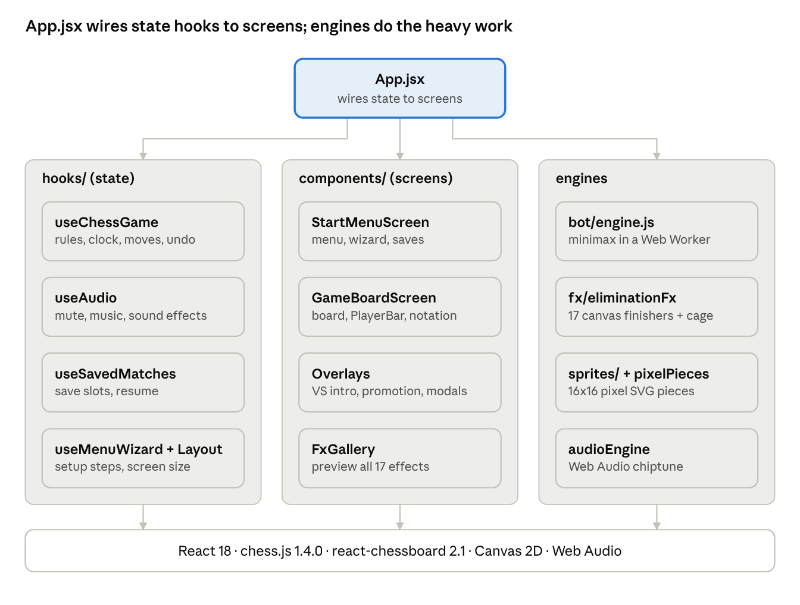

# NEO CHESS DX — Project Documentation

Last updated: Oct 16, 2026

## Overview

NEO CHESS DX is a browser chess game in 8-bit pixel-art style: a plumber-kingdom RED army against a speed-zone hedgehog BLUE army, with a CPU opponent at three difficulty levels and 17 animated elimination effects. It runs on desktop, tablets and phones from a single React app.

- Live: [neo-chess-xd.vercel.app](https://neo-chess-xd.vercel.app)
- Source: [github.com/BryxCinco/NeoChessXd](https://github.com/BryxCinco/NeoChessXd)
- Modes: 1 vs 1 on the same device, or player vs CPU (Easy, Normal, Hard)
- Rules: full chess rules from chess.js, including castling, en passant, promotion to any piece, and every draw rule

## Tech stack

The game is a static single-page app: no backend, no database, no account. Everything runs in the browser and is served from Vercel.

| Layer | Technology | Used for |
| --- | --- | --- |
| UI framework | React 18.3 | Components, hooks, game state |
| Build tool | Vite 5.4 | Dev server, production bundle, Web Worker bundling |
| Chess rules | chess.js 1.4.0 (pinned) | Legal moves, check/mate/draw detection, FEN and PGN |
| Board | react-chessboard 2.1 | Board rendering, drag-and-drop, square clicks |
| CPU opponent | Custom engine in a Web Worker | Minimax search off the main thread |
| Pixel art | Inline SVG from 16x16 character grids | All 12 piece sprites |
| Effects | HTML Canvas 2D | Capture effects, checkmate cage |
| Sound | Web Audio API | Generated chiptune BGM and sound effects, no audio files |
| Styling | Plain CSS, Press Start 2P font | 8-bit look, responsive layouts, CSS animations |
| Storage | Browser localStorage | Auto-saved session, save slots, mute setting |
| Linting | ESLint 9 with React plugins | Code checks |
| Hosting | Vercel | Auto-deploy on every push to `main` |

chess.js is pinned to an exact version because the bot uses its internal move API for speed.

## Features

**Playing**

- 1 vs 1 local or player vs CPU, with RED always moving first
- Time controls: no limit, 0:30, 1:00, 5:00, 10:00 or 30:00 per side
- Clocks pause during menus, the countdown, promotion and capture animations; running out of time ends the game, or draws it when the opponent has no mating material
- Drag-and-drop or tap-to-move, with dots on legal squares and red frames on captures
- Highlights for the last move and a king in check, plus a CHECK! screen flash
- Undo and redo; in a CPU game, undo skips back past the CPU's reply
- Pawn promotion picker with pixel sprites of all four pieces and a cancel button
- Draw detection with the reason shown: stalemate, threefold repetition, 50-move rule, insufficient material

**During a game**

- Player bars above and below the board with avatar, clock, captured pieces and material lead (for example +3)
- Move scoresheet in standard notation
- Status panel showing whose turn it is, or CPU THINKING... while the bot searches
- Pause menu: continue, restart, save game, quit to menu

**Saving**

- The current game auto-saves and resumes after a refresh
- Named save slots with date, mode and time setting; load or delete from the menu
- Saves store the full move history (PGN), so repetition rules and the scoresheet survive loading

**Audio**

- Chiptune menu music and a different sound for each effect, all generated live by Web Audio
- AUDIO: ON/OFF mutes music and effects and is remembered between visits

## CPU bot

The CPU plays BLUE and searches moves in a Web Worker, so the board, clocks and effects stay smooth while it thinks. It always waits at least 0.45 s so an instant reply doesn't look like a glitch.

| Difficulty | Search depth | Capture search | Random move chance | Score noise | Time budget |
| --- | --- | --- | --- | --- | --- |
| Easy | 1 move | No | 30% | ±120 | 0.15 s |
| Normal | 2 moves | Yes | 5% | ±30 | 0.5 s |
| Hard | up to 5 moves | Yes | 0% | none | 1.5 s |

How the engine works ([src/bot/engine.js](https://github.com/BryxCinco/NeoChessXd/blob/main/src/bot/engine.js)):

1. Negamax search with alpha-beta pruning, deepening one level at a time until the time budget runs out.
2. Quiescence search keeps following captures at the end of the line, so the bot sees recaptures before it grabs a defended piece.
3. Evaluation = material (pawn 100, knight 320, bishop 330, rook 500, queen 900) plus piece-square tables; the king switches to an endgame table when little material is left.
4. Moves are ordered most valuable victim first, and the score is updated per move instead of re-scanning the board.
5. It uses chess.js's internal move generator directly, which is about 20x faster than the public API; if those internals ever change, it falls back to a simple capture-first move.

## Pixel art and UI

Every piece is a 16x16 sprite written as text: one character per pixel, mapped to a colour palette in [src/sprites/pieceSprites.js](https://github.com/BryxCinco/NeoChessXd/blob/main/src/sprites/pieceSprites.js). At load time each colour is merged into a single SVG path, so a piece is only a handful of elements.

| Piece | RED army (plumber kingdom) | BLUE army (speed-zone hedgehogs) |
| --- | --- | --- |
| Pawn | Plumber with cap, mustache and overalls | Hedgehog with quills, green eyes, red shoes |
| Knight | White horse with a red cap | Blue horse with a spiky mane |
| Bishop | Spotted mushroom mitre | Pointed hat with a gold ring |
| Rook | Red brick castle tower | Green-hill checkered tower |
| Queen | Princess with crown and gown | Hedgehog queen with crown |
| King | Crowned king with a big mustache | Hedgehog king with crown and red cape |

Pieces bob and blink with stepped CSS animations.

**Screens**

- Main menu: animated NEO CHESS DX logo, RED vs BLUE army line-up, and FX GALLERY button; phones and tablets get a step-by-step setup wizard, desktops a single config panel plus saved matches
- Loading: a fighting-game VS screen with sliding team panels, 3-2-1-GO! countdown, pixel load bar and a random tip
- Game: opponent bar above the board, your bar below; a sidebar with status and scoresheet on desktop, stacked underneath on phones, beside the board on landscape phones
- Game over: the winning king's sprite and the result, with replay or main menu
- Background: a scrolling pixel starfield with scanlines and a vignette

## Elimination effects

A captured piece is lifted off the board and its own sprite is destroyed on a canvas overlay, in a style chosen by the capturing piece. Each piece has 2-3 finishers used in rotation, 17 in all, each with its own sound and a "+N" score popup (pawn 1, knight/bishop 3, rook 5, queen 9).

| Capturing piece | Finisher | What happens to the captured piece |
| --- | --- | --- |
| Pawn | Stomp | A boot drops on it; it squashes flat in a puff of smoke and stars |
| Pawn | Arrow Rain | A volley of arrows pins it, then it topples over |
| Pawn | Bubble Trap | Trapped in a bubble, it floats up and POPs into pixels |
| Knight | Slash | Cut diagonally; the two halves slide apart and fall |
| Knight | Bat Swarm | Bats circle it and carry it off pixel by pixel |
| Knight | Sandworm | A worm bursts from the ground and swallows it |
| Bishop | Deep Freeze | Ice climbs up from its feet, cracks, and it shatters |
| Bishop | Thunder | Struck by lightning, it x-ray flickers and crumbles to ash |
| Bishop | Plasma Surge | Orbiting plasma orbs charge it until it dissolves |
| Rook | Anvil Drop | An anvil crushes it; pixels spray sideways |
| Rook | Missile | A rocket streaks in and blows it apart |
| Rook | Sniper | A crosshair locks on; one shot knocks it down |
| Queen | Black Hole | Every pixel spirals into a collapsing void |
| Queen | UFO Abduction | A tractor beam lifts it into a UFO that zooms away |
| Queen | Giant Hand | A giant glove grabs it and yanks it off the board |
| King | Burn | Fire eats it from the feet up, leaving embers |
| King | Nuke | A bomb drops: white-out flash, shockwave, mushroom cloud |

**Checkmate:** the mating move lands first, then an iron cage on a chain drops over the losing king, bounces and locks with a flashing gold padlock. A CHECKMATE! banner and a board shake follow, and the game-over screen opens about 1.6 s later.

**FX GALLERY:** a button on the main menu opens a mini 5x5 board where any finisher can be played on a rotating set of pieces, or all 17 back to back with PLAY ALL.

## Performance on phones

The main rule: the clock ticks several times a second, but only the clock text should repaint.

- The board (64 squares, 32 SVG sprites), player bars and scoresheet are memoized and only re-render when the position, size or highlights change
- Bot search runs in a Web Worker, never on the UI thread
- Effects are time-based and capped at 60 fps, so 90/120 Hz phones don't do double work and every screen shows the same timing
- Phones get about 60% of the particles; the effects canvas is sized to the device pixel ratio (max 2x) so it stays crisp
- The effect loop stops when nothing is animating; the checkmate cage freezes in place instead of redrawing forever
- Piece and background animations use `steps()` and `transform`, so they repaint a few times per cycle or run on the compositor; all of them turn off with the system's reduce-motion setting
- Auto-save builds the PGN after each move and every 3 s, not on every clock tick
- Double-tap zoom is blocked with CSS `touch-action` instead of a JavaScript touch handler

## Project structure



useChessGame is the hub: it asks the bot worker for CPU moves and calls the effects engine on every capture and checkmate. The screens only read state and send player actions back.

| Path | What lives there |
| --- | --- |
| `src/App.jsx` | Top-level layout, top bar (undo, menu, redo), modal wiring |
| `src/hooks/` | useChessGame, useAudio, useSavedMatches, useMenuWizard, useResponsiveLayout |
| `src/components/` | Menu, board screen, PlayerBar, scoresheet, VS intro, promotion picker, modals, FX gallery, logo |
| `src/bot/` | engine.js (search), botWorker.js (worker), requestBotMove.js (main-thread bridge) |
| `src/fx/eliminationFx.js` | All 17 elimination finishers and the per-piece rotation |
| `src/usePixelAnimation.js` | Canvas loop, checkmate cage, effect triggers |
| `src/sprites/pieceSprites.js` | Pixel grids and palette for the 12 pieces |
| `src/pixelPieces.jsx` | Turns sprites into SVG for the board and UI |
| `src/audioEngine.js` | Generated music and sound effects |
| `src/App.css` | All styling, layouts and animations |

## Running, building and deploying

You need Node.js and npm.

```bash
git clone https://github.com/BryxCinco/NeoChessXd.git
cd NeoChessXd
npm install
npm run dev       # local dev server
npm run build     # production bundle in dist/
npm run preview   # serve the built bundle locally
npm run lint      # ESLint
```

Deploying: Vercel builds and publishes every push to `main` automatically; the commit on GitHub shows a check when the deploy is done. There are no environment variables or server settings to configure.
